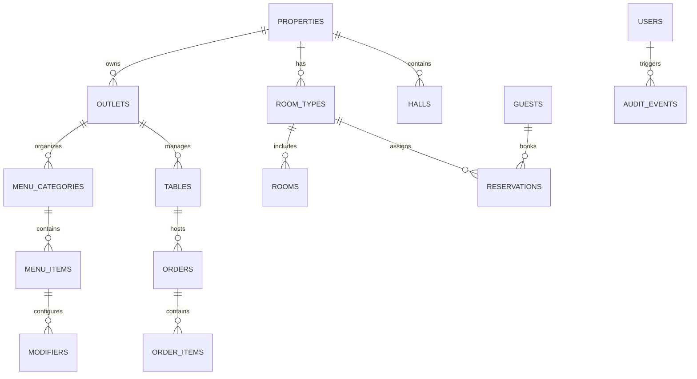

# 🏰 Aura Grand Palace — Codebase & File Structure Guide

> **A comprehensive architectural chart and reference manual explaining every file and folder in the project, why it exists, what it does, and how all layers connect together.**

---

## 📌 Table of Contents

1. [High-Level Architecture & Layered Design](#1-high-level-architecture--layered-design)
2. [Complete Visual Folder Chart (Tree Structure)](#2-complete-visual-folder-chart-tree-structure)
3. [Root Configuration Files](#3-root-configuration-files)
4. [Public Assets (`/public`)](#4-public-assets-public)
5. [Application Routing Layer (`src/app`)](#5-application-routing-layer-srcapp)
   - [5.1 Public Guest Pages](#51-public-guest-pages)
   - [5.2 Authentication & User Profiles](#52-authentication--user-profiles)
   - [5.3 Food Ordering & Contactless QR](#53-food-ordering--contactless-qr)
   - [5.4 Staff Operations Console (`/dashboard`)](#54-staff-operations-console-dashboard)
   - [5.5 REST API Endpoints (`src/app/api`)](#55-rest-api-endpoints-srcappapi)
6. [Reusable Components Layer (`src/components`)](#6-reusable-components-layer-srccomponents)
   - [6.1 Layout Components (`components/layout`)](#61-layout-components-componentslayout)
   - [6.2 Guest & Home Components (`components/home`)](#62-guest--home-components-componentshome)
   - [6.3 Authentication Components (`components/auth`)](#63-authentication-components-componentsauth)
   - [6.4 Base UI & Heritage Art (`components/ui`)](#64-base-ui--heritage-art-componentsui)
7. [Business Logic, Services & Utilities (`src/lib`)](#7-business-logic-services--utilities-srclib)
   - [7.1 Dual-Mode Data Repository (`lib/data`)](#71-dual-mode-data-repository-libdata)
   - [7.2 Service Layer (`lib/services`)](#72-service-layer-libservices)
   - [7.3 Supabase Clients & Auth Middleware (`lib/supabase`)](#73-supabase-clients--auth-middleware-libsupabase)
   - [7.4 Types & Shared Utilities (`lib/types`, `lib/utils`)](#74-types--shared-utilities-libtypes-libutils)
8. [Database Schemas & Migrations (`/supabase`)](#8-database-schemas--migrations-supabase)
9. [Key System Data Flows](#9-key-system-data-flows)

---

## 1. High-Level Architecture & Layered Design

The system follows a clean **N-Tier Layered Architecture** with strict separation of concerns:

```
┌────────────────────────────────────────────────────────────────────────┐
│                        PRESENTATION LAYER                              │
│  Guest Portal (Next.js 16 SSR/SSG)  │  Staff Operations Cockpit (CSR)  │
└────────────────────────────────────┬───────────────────────────────────┘
                                     │
┌────────────────────────────────────▼───────────────────────────────────┐
│                          API & ROUTING LAYER                           │
│  Next.js 16 App Router (/app)       │  18 REST API Endpoints (/api)    │
└────────────────────────────────────┬───────────────────────────────────┘
                                     │
┌────────────────────────────────────▼───────────────────────────────────┐
│                         SERVICE & DOMAIN LAYER                         │
│  Business Rules (Rooms, Orders, Menu, Tables, Leads, Payments, RBAC)   │
└────────────────────────────────────┬───────────────────────────────────┘
                                     │
┌────────────────────────────────────▼───────────────────────────────────┐
│                       DATA PERSISTENCE LAYER                           │
│  Dual-Mode Data Repository (Auto-switching between Supabase & Memory)  │
├────────────────────────────────────┬───────────────────────────────────┤
│  Supabase Cloud (PostgreSQL 15+)   │  In-Memory Seed Store (Mock Dev)  │
└────────────────────────────────────┴───────────────────────────────────┘
```

---

## 2. Complete Visual Folder Chart (Tree Structure)

```text
HotelManagement/
├── .env.example                               # Environment template with dummy variables
├── .env.local                                 # Local secrets (Supabase keys, port) [Git Ignored]
├── .gitignore                                 # Git exclusion rules (node_modules, .env*, .next)
├── AGENTS.md                                  # Next.js 16 agent & developer conventions
├── eslint.config.mjs                          # ESLint 9 linting rules
├── next.config.ts                             # Next.js 16 configuration (Turbopack, redirects, image origins)
├── package.json                               # Dependencies, scripts, and package metadata
├── tsconfig.json                              # TypeScript strict configuration & path aliases (@/*)
├── README.md                                  # Project overview and quick start guide
├── PROJECT_STRUCTURE.md                       # Complete file chart and workings manual (This file)
│
├── public/                                    # Static assets served at root /
│   ├── fonts/                                 # Custom Cormorant Garamond TTF fonts
│   └── images/                                # Heritage hotel photography, decor, avatars, dining
│       ├── dining/                            # Restaurant and cafe interior artwork
│       ├── events/                            # Banquet, reception, and folk dance photography
│       ├── food/                              # Rajasthani culinary dishes (Dal Baati, Laal Maas, etc.)
│       ├── hall/                              # Crystal Ballroom & celebration setups
│       ├── heritage-elements/                 # Palace line art and architectural arches
│       ├── heritage-reference/                # Ornamental frames and divider borders
│       ├── ornaments/                         # Lotus motifs, floral runners, borders
│       ├── reels/                             # InstaLook Book video reel thumbnails
│       ├── rooms/                             # High-res suites (Haveli Suite, Jharokha Room)
│       └── testimonials/                      # Guest avatar photography
│
├── src/
│   ├── app/                                   # Next.js 16 App Router & Endpoint definitions
│   │   ├── globals.css                        # Tailwind CSS v4 setup, variables & royal themes
│   │   ├── figma-heritage.css                 # Classical serif typography and heritage tokens
│   │   ├── layout.tsx                         # Root HTML shell with Navbar, Footer, MobileNav
│   │   ├── page.tsx                           # Palace Home Landing Portal (/)
│   │   │
│   │   ├── hotel/                             # Consolidated Hotel & Banquet showcase (/hotel)
│   │   │   └── page.tsx                       # Deluxe suites + Grand Party Hall with enquiry form
│   │   ├── restaurant/                        # Unified Dining & Cafe experience (/restaurant)
│   │   │   └── page.tsx                       # Royal dining thalis + Jharokha Cafe brews & menu
│   │   ├── rooms/                             # Suites catalog and room filtering (/rooms)
│   │   │   ├── page.tsx                       # Filterable room inventory view
│   │   │   └── [roomTypeId]/                  # Individual room type details (/rooms/:id)
│   │   │       ├── page.tsx                   # Server-side metadata & room loader
│   │   │       └── room-detail-client.tsx     # Client-side gallery, amenities & booking CTA
│   │   ├── book/                              # Direct room reservation engine (/book)
│   │   │   └── page.tsx                       # Live stay duration, guest count, tax & booking form
│   │   │
│   │   ├── order/                             # Online takeaway & food delivery (/order)
│   │   │   ├── pickup/page.tsx                # Express kitchen pickup checkout
│   │   │   └── delivery/page.tsx              # Local delivery checkout with address & distance rules
│   │   ├── order-status/[reference]/          # Live food order progress tracker
│   │   │   └── page.tsx                       # Visual lifecycle bar (Received -> Preparing -> Ready)
│   │   ├── qr/[token]/                        # Contactless table-side digital menu
│   │   │   └── page.tsx                       # Scanned table ordering with visual cart drawer
│   │   │
│   │   ├── login/page.tsx                     # Customer login page (Supabase Auth)
│   │   ├── signup/page.tsx                    # Customer registration page
│   │   ├── profile/page.tsx                   # Guest account dashboard & reservation history
│   │   ├── auth/                              # Internal auth callback & reset handlers
│   │   │   ├── callback/route.ts              # OAuth & email verification exchange handler
│   │   │   ├── login/page.tsx                 # Alternative auth gateway
│   │   │   └── reset-password/page.tsx        # Password recovery page
│   │   │
│   │   ├── dashboard/                         # 18 Staff Operations Consoles (/dashboard)
│   │   │   ├── layout.tsx                     # Dark espresso sidebar, live notifications, auth guard
│   │   │   ├── page.tsx                       # Executive Cockpit with live daily KPIs & revenue
│   │   │   ├── reservations/page.tsx          # Front-desk check-in, check-out & guest folios
│   │   │   ├── bookings/page.tsx              # Advanced multi-filter reservations matrix
│   │   │   ├── rooms/page.tsx                 # Chamber inventory & real-time occupancy grid
│   │   │   ├── housekeeping/page.tsx          # Housekeeping tasks, cleaning states & room turnover
│   │   │   ├── pos/page.tsx                   # Touchscreen Point of Sale terminal for waitstaff
│   │   │   ├── kitchen/page.tsx               # Kitchen Display System (KDS) live chef ticket board
│   │   │   ├── orders/page.tsx                # Omnichannel live food orders manager
│   │   │   ├── waiter/page.tsx                # Floor steward terminal for open table tabs
│   │   │   ├── menu/page.tsx                  # Culinary catalog editor & instant 86'ing out-of-stock toggle
│   │   │   ├── modifiers/page.tsx             # Menu add-ons, portion sizes, and modifier groups
│   │   │   ├── tables/page.tsx                # Restaurant table layout & floor plan manager
│   │   │   ├── qr/page.tsx                    # Automatic QR code generator with printable templates
│   │   │   ├── outlets/page.tsx               # Multi-outlet settings (operating hours, fees, GST)
│   │   │   ├── hall/page.tsx                  # Banquet event leads pipeline & quote generator
│   │   │   ├── customers/page.tsx             # Guest CRM, lifetime spend & stay frequency profiles
│   │   │   ├── staff/page.tsx                 # Staff directory & Role-Based Access Control (RBAC)
│   │   │   ├── inventory/page.tsx             # Kitchen pantry stock ledger & low-stock alerts
│   │   │   ├── promotions/page.tsx            # Promo discounts & marketing banner controls
│   │   │   ├── reviews/page.tsx               # Guest review moderation & feedback dashboard
│   │   │   ├── media/page.tsx                 # Video reels & photo memory upload manager
│   │   │   ├── reports/page.tsx               # Financial analytics, ADR, RevPAR & sales charts
│   │   │   ├── audit/page.tsx                 # Tamper-evident system activity and security audit trail
│   │   │   └── settings/page.tsx              # Hotel property branding, policies & GST tax settings
│   │   │
│   │   └── api/                               # 18 Modular REST API Routes (/api/*)
│   │       ├── reservations/route.ts          # GET list, POST new room booking
│   │       ├── reservations/[id]/route.ts     # GET detail, PATCH status, DELETE reservation
│   │       ├── rooms/route.ts                 # GET rooms list with type and housekeeping state
│   │       ├── rooms/[id]/route.ts            # PATCH housekeeping state and room assignment
│   │       ├── hall/route.ts                  # GET event slots, POST banquet inquiry lead
│   │       ├── hall/[id]/route.ts             # PATCH event lead status, quotes, and deposits
│   │       ├── menu/route.ts                  # GET full menu, POST new dish
│   │       ├── menu/[id]/route.ts             # PATCH item price, description, stock status (86)
│   │       ├── menu/categories/route.ts       # GET & POST menu category groupings
│   │       ├── modifiers/route.ts             # GET & POST modifier groups
│   │       ├── modifiers/[id]/route.ts        # PATCH modifier pricing and options
│   │       ├── orders/route.ts                # GET all orders, POST new kitchen order
│   │       ├── orders/[id]/route.ts           # PATCH order stage (preparing -> ready -> delivered)
│   │       ├── tables/route.ts                # GET tables with active occupancies
│   │       ├── qr/route.ts                    # Dynamic QR code dataURL generator
│   │       ├── outlets/route.ts               # GET & PUT outlet operating configurations
│   │       ├── customers/route.ts             # GET CRM guest directory & total spend metrics
│   │       ├── staff/route.ts                 # GET staff members, POST new staff user
│   │       ├── staff/check/route.ts           # Validate current user staff credentials
│   │       ├── promotions/route.ts            # GET active offers, POST promo discount code
│   │       ├── promotions/[id]/route.ts       # PATCH promo validity and discount rate
│   │       ├── reviews/route.ts               # GET guest reviews, POST new review
│   │       ├── reviews/[id]/route.ts          # PATCH review approval status
│   │       ├── reels/route.ts                 # GET reels lookbook video feed
│   │       ├── reels/[id]/like/route.ts       # Increment reel like counter
│   │       ├── memories/route.ts              # GET event memory photos, POST guest photo
│   │       ├── memories/[id]/like/route.ts    # Increment photo memory likes
│   │       ├── reports/route.ts               # Financial & occupancy analytics aggregation
│   │       ├── audit/route.ts                 # System audit log query endpoint
│   │       ├── auth/signup/route.ts           # Custom guest registration handler
│   │       ├── settings/tables/route.ts       # Bulk table setup and numbering
│   │       └── upload/route.ts                # Local media file upload handler
│   │
│   ├── components/                            # Modular React 19 UI Components
│   │   ├── layout/                            # Sitewide navigation and footer structures
│   │   │   ├── navbar.tsx                     # Royal Maroon header with dynamic auth & role badges
│   │   │   ├── footer.tsx                     # Regal footer with property details & quick links
│   │   │   └── mobile-nav.tsx                 # Fixed bottom navigation for mobile screens
│   │   ├── home/                              # Landing page interactive sections
│   │   │   ├── booking-bar.tsx                # Floating availability check & dates picker
│   │   │   ├── deluxe-rooms-section.tsx       # Luxury chambers preview cards with pricing
│   │   │   ├── party-hall-section.tsx         # Grand celebration hall showcase & booking form
│   │   │   ├── insta-lookbook.tsx             # Interactive Instagram-style video reels player
│   │   │   ├── event-memories.tsx             # Palace events photo gallery with like counters
│   │   │   ├── royal-memories.tsx             # Guest storytelling memory submission form
│   │   │   ├── promotions.tsx                 # Countdown timer banners for seasonal discounts
│   │   │   └── testimonials.tsx               # Verified guest reviews carousel with avatars
│   │   ├── auth/                              # Authentication helper dialogs & branding
│   │   │   ├── auth-logo.tsx                  # Royal palace emblem with dual gold filigree
│   │   │   ├── auth-corner-art.tsx            # Rajputana corner ornaments for auth screens
│   │   │   ├── forgot-password-modal.tsx      # Modal for requesting password reset emails
│   │   │   └── terms-modal.tsx                # Hotel policies and terms of stay dialog
│   │   └── ui/                                # Base visual primitives & heritage vector artwork
│   │       ├── button.tsx                     # Reusable styled buttons (variants: gold, maroon, ghost)
│   │       ├── card.tsx                       # Glassmorphic and bordered content containers
│   │       ├── badge.tsx                      # Status indicator badges (Available, Veg, Non-Veg)
│   │       ├── input.tsx                      # Styled text and number inputs with gold focus rings
│   │       ├── modal.tsx                      # Accessible dialog wrapper with backdrop blur
│   │       ├── heritage-art.tsx               # Scalable SVG crests, elephant procession banners, chhatris
│   │       └── heritage-ornaments.tsx         # Mandala ornaments, Lata Jaali borders, Paisley Kalka art
│   │
│   └── lib/                                   # Business logic, database abstraction & utilities
│       ├── data/                              # Data storage implementations
│       │   ├── repository.ts                  # Dual-Mode Data Repository (Supabase ↔ In-Memory switch)
│       │   └── initial-data.ts                # Complete mock dataset for instant zero-config dev
│       ├── services/                          # Domain service layer (wraps Supabase & business rules)
│       │   ├── rooms-service.ts               # Room types, physical rooms, and occupancy math
│       │   ├── reservations-service.ts        # Booking references, check-in, check-out, taxes
│       │   ├── menu-service.ts                # Menu categories, dishes, and 86'ing stock logic
│       │   ├── modifiers-service.ts           # Add-on groups and price modification
│       │   ├── orders-service.ts              # Omnichannel order tickets, KDS stages, and totals
│       │   ├── hall-service.ts                # Banquet inquiry leads, slots, and quotes
│       │   ├── promotions-service.ts          # Promo code discounts and validity periods
│       │   ├── reviews-service.ts             # Guest rating aggregation and moderation
│       │   ├── reels-service.ts               # Video reel feed and social metrics
│       │   ├── memories-service.ts            # Photo memories feed and upload persistence
│       │   └── supabase-helper.ts             # Connection health checker & failover detector
│       ├── supabase/                          # Supabase SDK configurations
│       │   ├── client.ts                      # Client-side Supabase client (browser anon key)
│       │   ├── server.ts                      # Server-side Supabase client (cookies & SSR safe)
│       │   ├── admin.ts                       # Elevated service-role client for admin operations
│       │   └── middleware.ts                  # Session refresher & route protection middleware
│       ├── types/                             # Comprehensive TypeScript type definitions
│       │   └── index.ts                       # 50+ interfaces covering all entities and API schemas
│       └── utils/                             # Shared utility functions
│           ├── money.ts                       # Currency formatting & integer paise minor unit math
│           ├── dates.ts                       # Date arithmetic, stay nights calculation, formatting
│           ├── constants.ts                   # GST tax rates (500 bps = 5%), branding metadata
│           └── validation.ts                  # Input format validators (Aadhaar, phone, email)
│
└── supabase/                                  # PostgreSQL Cloud Database definitions
    ├── migrations/                            # Modular SQL migrations
    │   ├── 001_property_outlets.sql           # Properties, outlets, and delivery zones
    │   ├── 002_rooms_reservations.sql         # Room types, rooms, guests, and reservations
    │   ├── 003_hall_events.sql                # Halls, booking slots, and banquet leads
    │   ├── 004_menu_items.sql                 # Menu categories, dishes, and modifiers
    │   ├── 005_tables_qr.sql                  # Dining tables and QR session tokens
    │   ├── 006_orders_payments.sql            # Orders, order items, and payment transactions
    │   ├── 007_bills_adjustments.sql          # Invoices, service charges, and discounts
    │   ├── 008_users_roles.sql                # Staff profiles, roles, and permissions
    │   ├── 009_audit_events.sql               # Security audit logging table and triggers
    │   ├── 010_rls_policies.sql               # Row-Level Security policies for multi-tenancy
    │   ├── 011_reels_and_memories.sql         # Social lookbook reels and guest photo memories
    │   ├── full_schema.sql                    # Consolidated master schema (runs in 1 click)
    │   └── seed_data.sql                      # Authentic Rajasthani starter dataset
    ├── complete_setup.sql                     # Combined schema + seed data runner
    └── seed.sql                               # Local Supabase CLI seed script
```

---

## 3. Root Configuration Files

| File | Purpose | Need | Internal Workings |
| :--- | :--- | :--- | :--- |
| **`.env.example`** | Environment variable template | Demonstrates required configuration keys without exposing production secrets. | Contains placeholders for `NEXT_PUBLIC_SUPABASE_URL`, `NEXT_PUBLIC_SUPABASE_ANON_KEY`, and `SUPABASE_SERVICE_ROLE_KEY`. |
| **`.env.local`** | Local environment secrets (Ignored in Git) | Stores real API credentials for connecting to Supabase during local development. | Read by Next.js at boot time to inject environment variables into server and browser environments. |
| **`.gitignore`** | Git version control exclusions | Prevents committing bulky dependencies, compiled output, and secret files. | Excludes `node_modules/`, `.next/`, `.env*` (while keeping `!.env.example`), and `.temp/`. |
| **`next.config.ts`** | Next.js 16 compiler & runtime config | Configures Turbopack, remote image domains, and server redirects. | Enables Turbopack CSS loaders, whitelists `images.unsplash.com`, and establishes permanent 308 redirects from `/hall` to `/hotel#party-hall-enquiry` and `/cafe` to `/restaurant#cafe`. |
| **`package.json`** | Dependencies & build scripts | Defines project dependencies and executable CLI scripts. | Specifies Next.js 16.4.2, React 19.3, `@supabase/supabase-js`, `@supabase/ssr`, `tailwindcss`, `lucide-react`, and scripts (`dev`, `build`, `start`, `lint`). |
| **`tsconfig.json`** | TypeScript compiler configuration | Enforces strict type checking and maps clean path aliases. | Configures `@/*` to map to `./src/*`, enables incremental builds, and enforces strict mode. |
| **`README.md`** | Public repository manual | Introduces the project to developers, provides setup instructions, and details features. | Rendered on GitHub as the homepage documentation of the repository. |
| **`PROJECT_STRUCTURE.md`** | Complete codebase architecture map | Deep technical documentation explaining every file, its purpose, and system data flows. | Serves as the primary onboarding and architectural reference for developers and maintainers. |

---

## 4. Public Assets (`/public`)

Static files placed in this folder are served directly by Next.js from the root URL `/`.

| Folder / File | Purpose & Contents | Need & How It Works |
| :--- | :--- | :--- |
| **`public/fonts/`** | Contains `cormorant-garamond-500.ttf`, `600.ttf`, `700.ttf`. | Ensures high-end royal typography renders reliably offline without relying on external CDN network requests. |
| **`public/images/rooms/`** | High-res photos of luxury suites (`haveli-royal-suite.png`, `heritage-jharokha-room.png`, `lakeview-palace-suite.png`). | Displayed on the `/rooms` catalog and `/rooms/[roomTypeId]` detail pages. |
| **`public/images/food/`** | Photos of authentic dishes (`dal-baati.jpg`, `laal-maas.jpg`, `gatte-ki-sabzi.jpg`, `ker-sangri.jpg`, `restaurant.jpg`, `cafe.jpg`). | Used in the `/restaurant` menu and signature dish carousels. |
| **`public/images/events/`** | Photos of palace celebrations (`wedding-mandap.jpg`, `grand-banquet.jpg`, `folk-dance.jpg`, `courtyard-night.jpg`). | Rendered in the event memories gallery on the homepage and `/hotel`. |
| **`public/images/ornaments/`** | High-definition transparent Rajasthan vector art (`border-line.png`, `center-lotus.png`, `floral-left.png`, `lookbook-left-art.png`). | Creates ornamental dividers and borders between page sections. |
| **`public/images/reels/`** | Video reel thumbnails (`destination-weddings.jpg`, `heritage-rooms.jpg`, `royal-dining.jpg`). | Displayed in the interactive Instagram Lookbook component on the homepage. |
| **`public/images/testimonials/`**| Guest portrait photos (`amit-mehta.jpg`, `neha-karan.jpg`, `priya-sharma.jpg`). | Rendered in the verified guest reviews section with 5-star badges. |

---

## 5. Application Routing Layer (`src/app`)

Next.js 16 App Router maps each folder containing a `page.tsx` file to a public or dashboard route.

### 5.1 Public Guest Pages

| Route | File Path | What is it? | Why is it needed & How it works |
| :--- | :--- | :--- | :--- |
| **`/`** | `src/app/page.tsx` | Palace Home Landing Portal | Main entry point for guests. Renders the hero palace showcase, dynamic availability booking bar, preview of luxury chambers, royal dining overview, video reels lookbook, event memories, and verified guest reviews. |
| **`/hotel`** | `src/app/hotel/page.tsx` | Consolidated Hotel & Celebrations | Unifies the hotel suites showcase and the Grand Party Hall into a single page. Features deluxe room amenity highlights and an interactive banquet booking enquiry form. |
| **`/restaurant`**| `src/app/restaurant/page.tsx` | Consolidated Dining & Café | Merges the fine-dining Rajasthani Restaurant with the Jharokha Artisan Café. Features jump-anchor navigation, signature dish spotlights, and full categorized menus with direct ordering CTAs. |
| **`/rooms`** | `src/app/rooms/page.tsx` | Chambers Catalog | Allows guests to browse all available suites with interactive filters (guest capacity, price range, tier, and amenities). |
| **`/rooms/[roomTypeId]`**| `src/app/rooms/[roomTypeId]/page.tsx` & `room-detail-client.tsx` | Individual Suite Details | Displays high-resolution gallery images, heritage architectural narratives, room specifications (sq ft, bed type, view), policies, and direct booking buttons. |
| **`/book`** | `src/app/book/page.tsx` | Instant Room Booking Engine | Calculates stay duration, party size, dynamic room rate snapshots, and 5% GST taxes. Generates a unique reference code (`RES-AUR-XXXX-XXXX`) and persists the reservation directly to Supabase. |

---

### 5.2 Authentication & User Profiles

| Route | File Path | What is it? | Why is it needed & How it works |
| :--- | :--- | :--- | :--- |
| **`/login`** | `src/app/login/page.tsx` | Customer Sign-In Screen | Lets guests log in with email and password via Supabase Auth. Displays decorative corner art and a link to the forgot password modal. |
| **`/signup`** | `src/app/signup/page.tsx` | Customer Registration | Allows new guests to create an account, storing their name, phone number, and email. Redirects to `/profile` on success. |
| **`/profile`** | `src/app/profile/page.tsx` | Guest Account Dashboard | Displays the logged-in guest's contact info, lifetime reservation history with live status badges (*Confirmed*, *Checked In*), and quick links to dining and bookings. |
| **`/auth/callback`**| `src/app/auth/callback/route.ts`| OAuth / Email Callback Handler | Server route that exchanges Supabase authentication tokens from confirmation emails for a secure session cookie. |
| **`/auth/reset-password`**| `src/app/auth/reset-password/page.tsx`| Password Reset Form | Allows users who clicked an email reset link to enter and confirm their new password. |

---

### 5.3 Food Ordering & Contactless QR

| Route | File Path | What is it? | Why is it needed & How it works |
| :--- | :--- | :--- | :--- |
| **`/qr/[token]`** | `src/app/qr/[token]/page.tsx` | Contactless Table-Side Digital Menu | Opened when a guest scans a QR code on a physical restaurant table. Identifies the table, loads the live menu, and allows submitting orders directly to the kitchen. |
| **`/order/pickup`**| `src/app/order/pickup/page.tsx`| Takeaway Checkout Portal | Express checkout for kitchen pickup. Collects guest contact details, displays preparation lead times, and calculates itemized totals. |
| **`/order/delivery`**| `src/app/order/delivery/page.tsx`| Home Delivery Checkout | Validates minimum order amounts, verifies delivery zones, calculates delivery fees, and dispatches the delivery ticket. |
| **`/order-status/[reference]`**| `src/app/order-status/[reference]/page.tsx`| Live Order Progress Tracker | Visual 4-step progress bar (*Received ➔ Preparing ➔ Ready ➔ Delivered*) allowing customers to track their food order in real time. |

---

### 5.4 Staff Operations Console (`/dashboard`)

All staff operational screens are grouped under `/dashboard` and protected by authentication guards:

| Route | File Path | Operational Role & Capabilities |
| :--- | :--- | :--- |
| **`/dashboard`** | `src/app/dashboard/page.tsx` | **Executive Cockpit**: Real-time KPIs (occupancy rate, today's arrivals & departures, active kitchen orders, pending banquet leads, daily revenue) and quick action shortcuts. |
| **`/dashboard/reservations`**| `src/app/dashboard/reservations/page.tsx`| **Front Desk Hub**: Search reservations by reference or guest name, perform 1-click check-in and check-out, allocate physical rooms, and view guest folios. |
| **`/dashboard/bookings`**| `src/app/dashboard/bookings/page.tsx`| **Reservations Matrix**: Multi-filter table of all bookings across past, present, and upcoming stays with export capabilities. |
| **`/dashboard/rooms`** | `src/app/dashboard/rooms/page.tsx` | **Chamber Grid**: Visual room matrix showing occupancy states (*Available, Occupied, Cleaning, Maintenance*) and room numbers. |
| **`/dashboard/housekeeping`**| `src/app/dashboard/housekeeping/page.tsx`| **Housekeeping Console**: Assign cleaning staff to rooms, mark rooms as cleaned/inspected, and log maintenance tickets. |
| **`/dashboard/pos`** | `src/app/dashboard/pos/page.tsx` | **Point of Sale (POS)**: High-speed touchscreen terminal for waitstaff and front desk to punch Dine-In, Takeaway, and Room Service orders. |
| **`/dashboard/kitchen`** | `src/app/dashboard/kitchen/page.tsx` | **Kitchen Display System (KDS)**: Real-time ticket management for chefs with ticket timers, urgency badges, and stage progression (*Preparing ➔ Ready ➔ Collected*). |
| **`/dashboard/orders`** | `src/app/dashboard/orders/page.tsx` | **Omnichannel Orders Hub**: Centralized log of all orders across QR dine-in, takeaway, delivery, and room service with live status controls. |
| **`/dashboard/waiter`** | `src/app/dashboard/waiter/page.tsx` | **Waiter Service Terminal**: Table-side screen for floor stewards to punch items, manage open table tabs, and track dishes ready for serving. |
| **`/dashboard/menu`** | `src/app/dashboard/menu/page.tsx` | **Culinary Catalog Editor**: Edit item prices, dietary labels (Veg/Non-Veg), and perform instant **86'ing** (one-click out-of-stock toggle). |
| **`/dashboard/modifiers`**| `src/app/dashboard/modifiers/page.tsx`| **Menu Modifiers**: Configure portion sizes (Regular/Large), preparation styles, and add-on pricing. |
| **`/dashboard/tables`** | `src/app/dashboard/tables/page.tsx` | **Table Floor Plan**: Configure restaurant tables, seating capacities, and active dining sessions. |
| **`/dashboard/qr`** | `src/app/dashboard/qr/page.tsx` | **QR Code Generator**: Automatically generates scannable QR codes for every table with downloadable print-ready templates. |
| **`/dashboard/outlets`**| `src/app/dashboard/outlets/page.tsx`| **Outlets Manager**: Configure operating hours, minimum delivery order values, delivery fees, and GST tax percentages. |
| **`/dashboard/hall`** | `src/app/dashboard/hall/page.tsx` | **Banquet Pipeline**: Event lead management (*New ➔ Contacted ➔ Quoted ➔ Confirmed*), seating layouts, and quotation generation. |
| **`/dashboard/customers`**| `src/app/dashboard/customers/page.tsx`| **Guest CRM**: Guest database with lifetime spend figures, visit frequency, contact details, and VIP tagging. |
| **`/dashboard/staff`** | `src/app/dashboard/staff/page.tsx` | **Staff Management & RBAC**: Manage employee profiles and assign permissions (*Admin, Manager, Front Desk, Kitchen, Waitstaff, Housekeeping*). |
| **`/dashboard/inventory`**| `src/app/dashboard/inventory/page.tsx`| **Pantry Stock Ledger**: Monitor kitchen ingredients, re-order thresholds, stock valuation, and supplier records. |
| **`/dashboard/promotions`**| `src/app/dashboard/promotions/page.tsx`| **Promotions Engine**: Create discount promo codes, active dates, and configure homepage banner campaigns. |
| **`/dashboard/reviews`**| `src/app/dashboard/reviews/page.tsx`| **Reviews Moderation**: Approve or hide guest testimonials and monitor rating distributions. |
| **`/dashboard/media`** | `src/app/dashboard/media/page.tsx` | **Media Manager**: Upload video reels and photo memories for the guest-facing lookbook. |
| **`/dashboard/reports`**| `src/app/dashboard/reports/page.tsx`| **Business Intelligence**: Financial analytics, RevPAR, ADR, revenue by department, and exportable CSV tables. |
| **`/dashboard/audit`** | `src/app/dashboard/audit/page.tsx` | **Security Audit Log**: Immutable record of system events, logins, status changes, order edits, and refunds. |
| **`/dashboard/settings`**| `src/app/dashboard/settings/page.tsx`| **System Settings**: Hotel branding, contact details, check-in/out policies, and taxation parameters. |

---

### 5.5 REST API Endpoints (`src/app/api`)

The backend exposes 18 modular API route groups matching standard REST conventions:

| Endpoint Route | Supported Methods | Description & Workings |
| :--- | :--- | :--- |
| **`/api/reservations`** | `GET`, `POST` | Lists all room reservations with optional filters; creates new guest room reservations. |
| **`/api/reservations/[id]`** | `GET`, `PATCH`, `DELETE` | Retrieves reservation details; updates status (*checked_in*, *checked_out*, *cancelled*); removes bookings. |
| **`/api/rooms`** | `GET` | Returns list of all physical rooms alongside room type metadata and housekeeping states. |
| **`/api/rooms/[id]`** | `PATCH` | Updates a specific room's housekeeping state (*available*, *dirty*, *cleaning*, *maintenance*). |
| **`/api/hall`** | `GET`, `POST` | Fetches banquet hall slots and packages; creates new event inquiry leads. |
| **`/api/hall/[id]`** | `PATCH` | Updates banquet lead lifecycle stage, quotation amounts, and deposit confirmations. |
| **`/api/menu`** | `GET`, `POST` | Retrieves the full categorized food menu; creates new menu items. |
| **`/api/menu/[id]`** | `PATCH` | Toggles item availability (86 stock toggle) and modifies pricing or descriptions. |
| **`/api/menu/categories`** | `GET`, `POST` | Fetches and manages culinary category groupings. |
| **`/api/modifiers`** | `GET`, `POST` | Fetches and creates dish modifier groups (sizes, toppings). |
| **`/api/modifiers/[id]`** | `PATCH` | Updates modifier pricing and active states. |
| **`/api/orders`** | `GET`, `POST` | Lists live food orders across all channels; submits new kitchen orders. |
| **`/api/orders/[id]`** | `PATCH` | Updates order stage (*preparing*, *ready*, *delivered*, *completed*). |
| **`/api/tables`** | `GET`, `POST` | Lists restaurant tables and their current dining status. |
| **`/api/settings/tables`** | `POST` | Performs bulk table numbering and layout configuration. |
| **`/api/qr`** | `GET` | Dynamically generates SVG and PNG QR code Data URLs for table tokens. |
| **`/api/outlets`** | `GET`, `PUT` | Fetches and updates outlet settings (operating hours, fees, taxes). |
| **`/api/customers`** | `GET`, `POST` | Returns guest CRM directory with calculated lifetime spend metrics. |
| **`/api/staff`** | `GET`, `POST` | Lists authorized staff members; registers new operational users. |
| **`/api/staff/check`** | `GET` | Verifies whether the currently logged-in user has staff dashboard access privileges. |
| **`/api/promotions`** | `GET`, `POST` | Fetches active discount campaigns; creates new promo codes. |
| **`/api/promotions/[id]`** | `PATCH` | Toggles promo code activation and discount rates. |
| **`/api/reviews`** | `GET`, `POST` | Fetches approved guest reviews; submits new customer ratings. |
| **`/api/reviews/[id]`** | `PATCH` | Moderates reviews (approves or hides from public display). |
| **`/api/reels`** | `GET`, `POST` | Returns video reels for the homepage lookbook. |
| **`/api/reels/[id]/like`** | `POST` | Atomically increments the like counter on a video reel. |
| **`/api/memories`** | `GET`, `POST` | Returns photo memories feed; accepts new guest event photos. |
| **`/api/memories/[id]/like`**| `POST` | Atomically increments the like counter on a memory photograph. |
| **`/api/reports`** | `GET` | Aggregates gross revenue, room turnover, dining turnover, ADR, and RevPAR. |
| **`/api/audit`** | `GET` | Returns immutable audit events log for security and compliance monitoring. |
| **`/api/auth/signup`** | `POST` | Custom guest sign-up handler that coordinates Supabase Auth with the guest database. |
| **`/api/upload`** | `POST` | Handles multipart file uploads and returns the stored public URL. |

---

## 6. Reusable Components Layer (`src/components`)

### 6.1 Layout Components (`components/layout`)

* **`navbar.tsx`**:
  * **What**: The royal sticky top header.
  * **Need**: Unified sitewide navigation for desktop and mobile devices.
  * **Workings**: Contains the palace mark crest, links (`Home`, `Hotel`, `Restaurant & Café`, `Contact`), language toggle (`Eng`/`हिन्दी`), and dynamically displays the gold **Admin Panel** badge when a logged-in user is verified as staff.
* **`footer.tsx`**:
  * **What**: The royal footer placed at the bottom of every page.
  * **Need**: Property address, telephone, email concierge, and quick links.
  * **Workings**: Features a gold filigree accent line, palace crest, quick links, and contact information. Automatically hides itself on `/dashboard` and auth screens.
* **`mobile-nav.tsx`**:
  * **What**: Fixed bottom navigation bar for mobile smartphones.
  * **Need**: Ergonomic mobile navigation for guests on smaller touchscreens.
  * **Workings**: Displays icons for *Home*, *Hotel*, *Dining*, and *Book*. Highlights the active route and automatically hides on `/dashboard` screens.

---

### 6.2 Guest & Home Components (`components/home`)

* **`booking-bar.tsx`**: Floating check-in bar on the hero section. Lets guests select arrival dates, stay duration, and party size, redirecting them to `/book` or `/hotel#party-hall-enquiry`.
* **`deluxe-rooms-section.tsx`**: Highlights the hotel's luxury suites with amenity badges (Wi-Fi, AC, 24x7 room service, in-room dining, valet parking) and direct booking triggers.
* **`party-hall-section.tsx`**: Showcases the Grand Party Hall (25-50 guests), package pricing, seating layouts, and an integrated event inquiry lead form.
* **`insta-lookbook.tsx`**: Video reels player with interactive play/pause controls, audio toggles, and live like counters.
* **`event-memories.tsx`**: Photographic gallery showcasing weddings, folk dance evenings, and grand banquets held at the palace.
* **`royal-memories.tsx`**: Modal allowing guests to share their own photos and stories from their stay.
* **`promotions.tsx`**: Real-time countdown banners highlighting seasonal packages and discount promo codes.
* **`testimonials.tsx`**: Carousel displaying verified guest reviews, star ratings, and guest avatars.

---

### 6.3 Authentication Components (`components/auth`)

* **`auth-logo.tsx`**: Scalable SVG emblem of the palace crest with gold filigree and royal typography.
* **`auth-corner-art.tsx`**: Ornamental Rajputana arches that frame the corners of authentication modals.
* **`forgot-password-modal.tsx`**: Dialog that collects the user's email address and triggers a Supabase password recovery email.
* **`terms-modal.tsx`**: Displays property rules, check-in requirements (mandatory 12-digit Aadhaar / Passport), and cancellation policies.

---

### 6.4 Base UI & Heritage Art (`components/ui`)

* **`button.tsx`**, **`card.tsx`**, **`badge.tsx`**, **`input.tsx`**, **`modal.tsx`**: Accessible, styled UI primitives adhering to the Warm Ivory, Royal Maroon, and Champagne Gold design tokens.
* **`heritage-art.tsx`**: Scalable vector art depicting royal emblems, elephant processions with howdahs, and palace chandeliers.
* **`heritage-ornaments.tsx`**: Symmetrical vector ornaments (Mandala concentric lotus circles, Lata Jaali vertical border runners, Paisley Kalka ornaments, and Chhatri eaves). Uses coordinate rounding (`roundCoord`) to eliminate floating-point hydration discrepancies.

---

## 7. Business Logic, Services & Utilities (`src/lib`)

### 7.1 Dual-Mode Data Repository (`lib/data`)

* **`repository.ts`**:
  * **What**: The central data access abstraction layer.
  * **Need**: Eliminates vendor lock-in and allows the entire app to run immediately with zero setup while also supporting full cloud PostgreSQL deployments.
  * **Workings**: Implements the `DataRepository` interface. It checks whether live Supabase credentials exist. If connected, operations run against live PostgreSQL tables. If disconnected, it seamlessly routes queries to `initial-data.ts`.
* **`initial-data.ts`**:
  * **What**: In-memory database seed store.
  * **Need**: Provides realistic starter data (suites, thali menus, tables, staff accounts, sample reservations) for testing and local exploration.

---

### 7.2 Service Layer (`lib/services`)

The service layer contains domain logic, data transformations, and input sanitization:

| Service File | Responsibilities |
| :--- | :--- |
| **`rooms-service.ts`** | Fetches suite categories, counts available physical rooms, and calculates occupancy rates. |
| **`reservations-service.ts`**| Validates check-in dates, generates reference codes, calculates nightly rates & GST, and manages status transitions. |
| **`menu-service.ts`** | Groups dishes by category, filters by dietary tags (Veg/Non-Veg/Jain), and toggles out-of-stock flags. |
| **`modifiers-service.ts`** | Attaches modifier groups (sizes, preparation styles) to dishes and calculates add-on prices. |
| **`orders-service.ts`** | Coordinates orders across POS, QR, and online channels; advances KDS kitchen stages. |
| **`hall-service.ts`** | Verifies banquet slot availability, registers event leads, and tracks quotation approvals. |
| **`promotions-service.ts`** | Validates coupon discount codes against order subtotals and expiration timestamps. |
| **`reviews-service.ts`** | Moderates submitted reviews and computes overall property star ratings. |
| **`reels-service.ts`** | Delivers video reel metadata and manages atomic like counts. |
| **`memories-service.ts`** | Manages photo memory albums and guest story submissions. |
| **`supabase-helper.ts`** | Monitors Supabase PostgreSQL connection health and signals automatic fallback. |

---

### 7.3 Supabase Clients & Auth Middleware (`lib/supabase`)

* **`client.ts`**: Instantiates the client-side Supabase client using `createBrowserClient` from `@supabase/ssr` for browser authentication and queries.
* **`server.ts`**: Instantiates the server-side Supabase client using `createServerClient` from `@supabase/ssr`, safely binding authentication tokens to request cookies.
* **`admin.ts`**: Uses `SUPABASE_SERVICE_ROLE_KEY` to bypass Row-Level Security for administrative operations like staff role verification.
* **`middleware.ts`**: Intercepts incoming requests to refresh expired auth cookies and protect sensitive staff dashboard routes.

---

### 7.4 Types & Shared Utilities (`lib/types`, `lib/utils`)

* **`types/index.ts`**: Defines strict TypeScript interfaces for all data structures (`Room`, `Reservation`, `MenuItem`, `Order`, `Table`, `StaffUser`, `AuditLog`, etc.).
* **`utils/money.ts`**: Formats monetary values to Indian Rupees (`₹`) and performs integer arithmetic in **paise (minor units)** to eliminate floating-point rounding errors.
* **`utils/dates.ts`**: Date formatting and stay night calculations using `date-fns`.
* **`utils/constants.ts`**: Property branding constants, tax rates (500 bps = 5% GST), and default operational parameters.
* **`utils/validation.ts`**: Form validators for 12-digit Indian Aadhaar numbers, 10-digit mobile numbers, and email formats.

---

## 8. Database Schemas & Migrations (`/supabase`)

The database is built on **PostgreSQL 15+** with relational foreign keys, automated timestamps, and Row-Level Security:



| Migration File | Tables Created | Key Purpose |
| :--- | :--- | :--- |
| **`001_property_outlets.sql`** | `properties`, `outlets`, `delivery_areas` | Defines multi-outlet hotel boundaries, delivery radius, operating hours, and GST tax rates. |
| **`002_rooms_reservations.sql`** | `room_types`, `rooms`, `guests`, `reservations` | Manages suite tiers, physical room numbers, guest contact cards, stay dates, and deposit balances. |
| **`003_hall_events.sql`** | `halls`, `hall_slots`, `event_leads` | Manages celebration banquets, seating arrangements, time slots, and quote proposals. |
| **`004_menu_items.sql`** | `menu_categories`, `menu_items`, `modifiers` | Stores dishes, prices in paise, dietary labels, stock flags, and portion add-ons. |
| **`005_tables_qr.sql`** | `tables`, `qr_tokens` | Tracks floor plan tables and maps scannable QR tokens to specific table sessions. |
| **`006_orders_payments.sql`** | `orders`, `order_items`, `payments` | Records omnichannel kitchen orders, item quantities, special instructions, and payment receipts. |
| **`007_bills_adjustments.sql`** | `bills`, `bill_items`, `discounts` | Manages final tax invoices, service charges, and promotional coupon discounts. |
| **`008_users_roles.sql`** | `users`, `roles`, `staff_profiles` | Implements Role-Based Access Control (*Admin, Manager, Front Desk, Kitchen, Waitstaff, Housekeeping*). |
| **`009_audit_events.sql`** | `audit_events` | Immutable log recording actor IDs, IP addresses, entity types, and before/after JSON states. |
| **`010_rls_policies.sql`** | *Security Policies* | Establishes PostgreSQL Row-Level Security ensuring tenant isolation and role restrictions. |
| **`011_reels_and_memories.sql`** | `reels`, `memories` | Manages public Instagram-style video reels and guest photo albums with atomic like counters. |
| **`full_schema.sql`** | *All 20+ Tables Consolidated* | Complete schema file to set up a brand new Supabase PostgreSQL database in a single execution. |
| **`seed_data.sql`** | *Initial Data Set* | Populates authentic Rajasthani suites, royal thalis, sample reservations, tables, and staff users. |

---

## 9. Key System Data Flows

### A. Direct Room Reservation Flow (`/book`)
```
1. Guest selects Room Type, Check-in & Check-out dates on /book
   │
2. Client computes nights count, base rate snapshot, and 5% GST (paise)
   │
3. POST /api/reservations (Guest details + stay parameters)
   │
4. reservations-service validates dates (check_out > check_in)
   │
5. Generates unique reference code (e.g. RES-AUR-2026-4821)
   │
6. Repository persists record to PostgreSQL (or in-memory mock store)
   │
7. Returns reservation confirmation modal with booking code
   │
8. Instantly visible on Front Desk Cockpit (/dashboard/reservations)
```

---

### B. Contactless QR Dining & Kitchen Dispatch Flow (`/qr/[token]`)
```
1. Guest scans physical table tent QR code (URL: /qr/t-101)
   │
2. Page verifies table token and identifies "Table 101"
   │
3. Guest adds dishes with modifiers to the visual cart drawer
   │
4. POST /api/orders (Table ID, items, special kitchen notes)
   │
5. orders-service assigns unique order number (e.g. ORD1045)
   │
6. Stage set to "received" -> dispatches to Kitchen Display System (KDS)
   │
7. /dashboard/kitchen alerts chefs with sound & timer badge
   │
8. Chef taps "Mark Preparing" ➔ "Mark Ready"
   │
9. Waiter terminal alerts floor steward to serve Table 101
```

---

*This reference manual reflects the architecture of Aura Grand Palace & Heritage Resort.*
