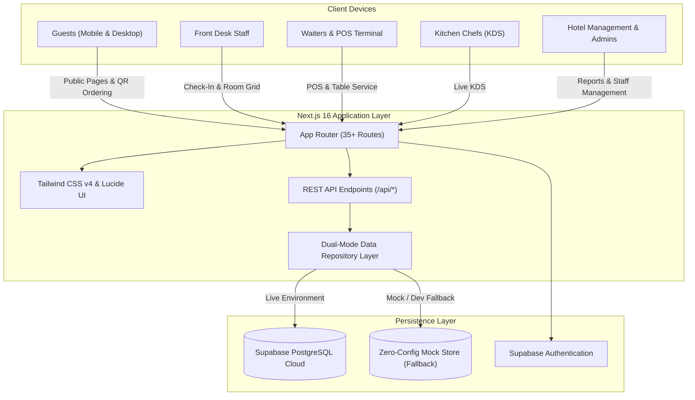

# 🏰 Aura Grand Palace & Heritage Resort

> **An enterprise-grade luxury hospitality management system and guest portal**, crafted for royal heritage palaces and high-end resorts. Inspired by the majestic royal architecture of Udaipur, Rajasthan, this platform unites guest-facing digital journeys with a comprehensive back-of-house operations cockpit.

[](https://nextjs.org/)
[](https://react.dev/)
[](https://www.typescriptlang.org/)
[](https://tailwindcss.com/)
[](https://supabase.com/)

---

## 📖 Table of Contents

- [Overview](#-overview)
- [Heritage Rajasthan Design System](#-heritage-rajasthan-design-system)
- [System Architecture](#-system-architecture)
- [What Has Been Done Yet](#-what-has-been-done-yet)
  - [1. Public Guest Web Experience](#1-public-guest-web-experience)
  - [2. Staff Operations Cockpit (`/dashboard`)](#2-staff-operations-cockpit-dashboard)
  - [3. Backend, APIs & Database Architecture](#3-backend-apis--database-architecture)
- [Project Directory Structure](#-project-directory-structure)
- [Getting Started](#-getting-started)
  - [Prerequisites](#prerequisites)
  - [Installation](#installation)
  - [Environment Configuration](#environment-configuration)
  - [Database Setup with Supabase](#database-setup-with-supabase)
  - [Running the Application](#running-the-application)
- [Default Portals & Route Directory](#-default-portals--route-directory)
- [Upcoming Roadmap](#-upcoming-roadmap)

---

## ⚜️ Overview

Modern luxury hotels often suffer from fragmented software ecosystems—using separate vendors for property management (PMS), restaurant point-of-sale (POS), kitchen display systems (KDS), event/banquet pipelines, and direct guest booking engines.

**Aura Grand Palace** unifies these critical functions into a single cohesive, high-performance web platform:
- **Direct Guest Booking**: Room suites, banquet halls, fine-dining table reservations, and contactless QR food ordering.
- **Enterprise Operations**: Front-desk room assignment, real-time housekeeping grids, live KDS for chefs, POS terminals for waitstaff, CRM guest tracking, culinary menu controls (86'ing), and financial analytics.
- **Dual-Mode Persistence**: Operates seamlessly on live cloud **Supabase PostgreSQL** or instantly falls back to an in-memory repository for zero-setup local development and automated testing.

---

## 🎨 Heritage Rajasthan Design System

The application is tailored around an authentic, opulent **Heritage Rajasthan** visual identity:

* **Regal Color Palette**:
  * **Warm Ivory (`#F5F1E8`)**: Canvas for public-facing guest spaces, providing high readability and a welcoming atmosphere.
  * **Royal Maroon (`#670E10`)**: Regal headers, badges, primary action buttons, and heritage crest accents.
  * **Espresso (`#241F1A` / `#181411`)**: Deep charcoal-espresso dark theme for operational cockpits and high-contrast typography (> 4.5:1 WCAG compliance).
  * **Champagne Gold (`#B08D57`)**: Decorative borders, filigree elements, star ratings, and luxury tags.
* **Typography**:
  * **Playfair Display**: Classical serif for royal suite titles, palace headers, and decorative accents.
  * **DM Sans / Inter**: Clean modern sans-serif for prices, operational data tables, forms, and mobile interfaces.
* **Financial Integrity**:
  * All currency figures represent the **Indian Rupee (`₹`)** and are stored strictly as **integer paise (minor units)** across the database, APIs, and UI calculations to eliminate floating-point arithmetic errors.

---

## 🛠️ System Architecture



---

## 🚀 What Has Been Done Yet

### 1. Public Guest Web Experience

| Realm | Route | Key Implemented Features |
| :--- | :--- | :--- |
| **Palace Landing Portal** | `/` | Hero video/image showcase, real-time check-in availability bar, 4 realm highlights, luxury chambers preview, guest reviews, dynamic Instagram lookbook / reels player, event memories showcase, and property credentials. |
| **Royal Chambers Explorer** | `/rooms` | Search & filter suites by guest capacity, suite tier, price range, and curated amenities. Dynamic availability badges. |
| **Chamber Details** | `/rooms/[roomTypeId]` | High-resolution suite imagery, heritage architectural narratives, curated amenities, policy breakdown, and direct booking CTA. |
| **Instant Booking Engine** | `/book` | Stay date picker, guest party size counters, automated night & 5% GST tax calculation, instant booking confirmation, reference code generation, and direct Supabase database insertion. |
| **Royal Darbar Banquet Hall** | `/hall` | Palace wedding & banquet showcase, package breakdown (*Maharani*, *Rajwada*, *Royal Corporate*), interactive seating layout selector (*Rajasthani Baithak*, *Cluster Tables*, *Auditorium*, *U-Shape*), and quotation lead pipeline. |
| **Darbar Fine Dining** | `/restaurant` | Royal thalis, Rajputana culinary specialties, dietary categorization (*Veg*, *Non-Veg*, *Jain*), table reservation forms, and dine-in QR entry point. |
| **Jharokha Artisan Cafe** | `/cafe` | Artisanal brews, Udaipur single-origin coffees, pastries, and quick takeaway ordering. |
| **Contactless QR Table Ordering** | `/qr/[token]` | Table-side QR code ordering with dynamic cart drawer, special dietary notes, and direct dispatch to the kitchen. |
| **Takeaway & Delivery Ordering** | `/order/pickup`, `/order/delivery` | Online ordering portal with customer contact inputs, delivery address check, delivery fees, and minimum order rules. |
| **Live Order Progress Tracker** | `/order-status/[reference]` | Real-time multi-stage visual timeline (*Received ➔ Preparing ➔ Ready ➔ Delivered*). |
| **Customer Authentication** | `/login`, `/signup`, `/auth/*`, `/profile` | Full Supabase Auth integration, password reset flows, user profiles, and past booking history. |

---

### 2. Staff Operations Cockpit (`/dashboard`)

The operations console is crafted in an ergonomic, high-contrast dark espresso palette (`#181411` / `#241F1A`) built for 24/7 hospitality staff shifts:

* **Executive Cockpit (`/dashboard`)**:
  * Real-time KPIs: Today's occupancy rate, arriving & departing guests, active kitchen tickets, pending banquet leads, and gross revenue.
  * Quick-launch action bar for check-ins, walk-in reservations, and order dispatches.
* **Reservations & Front Desk (`/dashboard/reservations`, `/dashboard/bookings`)**:
  * Live reservation search by reference code, guest name, or phone number.
  * Check-in and check-out workflows with room key assignments and folio breakdowns.
* **Room Management & Housekeeping (`/dashboard/rooms`, `/dashboard/housekeeping`)**:
  * Visual room status matrix (*Available, Occupied, Dirty, Cleaning, Maintenance*).
  * One-click housekeeping assignment and maintenance log updates.
* **Kitchen Display System - KDS (`/dashboard/kitchen`)**:
  * Live ticket board for line cooks and executive chefs.
  * Dynamic ticket timers with urgent alerts for tickets exceeding standard preparation times.
  * One-tap ticket progression: *Mark Preparing ➔ Mark Ready ➔ Mark Collected*.
* **Point of Sale - POS Terminal (`/dashboard/pos`)**:
  * High-speed touch grid designed for front-desk clerks and waitstaff.
  * Instant switching between *Dine-In*, *Takeaway*, and *Room Service*.
  * Fast category switching, modifier selection (sizes, toppings), and one-tap checkout.
* **Waiter Service Terminal (`/dashboard/waiter`)**:
  * Waitstaff view for active dining room tables, order punching, and serving alerts.
* **Live Orders Hub (`/dashboard/orders`)**:
  * Centralized pipeline managing all incoming orders across QR dine-in, takeaway, delivery, and room service.
  * Full status transition control, payment method tracking, and itemized invoice modals.
* **Culinary Menu & Modifiers Manager (`/dashboard/menu`, `/dashboard/modifiers`)**:
  * Instant **86'ing** (one-click out-of-stock toggle for kitchen ingredients).
  * Category reordering, dietary badge assignments, price adjustments, and modifier configuration.
* **Floor Plan & QR Code Engine (`/dashboard/tables`, `/dashboard/qr`)**:
  * Digital table management with capacity and outlet association.
  * Automated unique QR code generation for every table with downloadable SVG/PNG templates for table tents.
* **Outlets & Delivery Zones (`/dashboard/outlets`)**:
  * Multi-outlet configuration (Restaurant, Cafe, Room Service) with distinct operating hours, delivery fees, minimum order amounts, and GST rates.
* **Banquet & Event Leads Pipeline (`/dashboard/hall`)**:
  * Full lead lifecycle tracker (*New ➔ Contacted ➔ Quoted ➔ Accepted ➔ Declined*).
  * Quotation generation tool with guest count validation and custom setup notes.
* **Customer Relationship Management - CRM (`/dashboard/customers`)**:
  * Guest directory with lifetime spend metrics, visit frequencies, contact information, and VIP tagging.
* **Staff Management & RBAC (`/dashboard/staff`)**:
  * Employee directory with role-based permissions (*Admin, Manager, Front Desk, Kitchen, Waitstaff, Housekeeping*).
* **Inventory & Procurement (`/dashboard/inventory`)**:
  * Stock levels, critical re-order threshold alerts, and supplier records.
* **Promotions & Offers (`/dashboard/promotions`)**:
  * Discount code engine, promotional banner controls, and campaign scheduling.
* **Guest Reviews Moderation (`/dashboard/reviews`)**:
  * Moderation queue for guest reviews, star ratings, and feedback analytics.
* **Media & Lookbook Management (`/dashboard/media`)**:
  * Upload and manage Instagram-style video reels and guest memory photo albums.
* **Business Intelligence & Financial Reports (`/dashboard/reports`)**:
  * Daily, weekly, and monthly revenue breakdowns across rooms, dining, and banquets.
  * Average daily rate (ADR), RevPAR, peak dining hours, and exportable data tables.
* **Tamper-Evident Audit Logs (`/dashboard/audit`)**:
  * Chronological log tracking user actions, logins, status changes, order edits, and refunds.
* **System Settings (`/dashboard/settings`)**:
  * Property branding, address, policies, tax configuration, and operational parameters.

---

### 3. Backend, APIs & Database Architecture

* **17+ REST API Route Endpoints**:
  * `/api/reservations` & `/api/reservations/[id]`: Room booking operations and folio updates.
  * `/api/rooms` & `/api/rooms/[id]`: Room status and housekeeping mutations.
  * `/api/hall` & `/api/hall/[id]`: Banquet slot bookings and lead inquiries.
  * `/api/menu`, `/api/menu/[id]`, `/api/menu/categories`: Menu management and category sorting.
  * `/api/modifiers` & `/api/modifiers/[id]`: Add-on and variant controls.
  * `/api/orders` & `/api/orders/[id]`: Kitchen ticket dispatch and status transitions.
  * `/api/tables` & `/api/settings/tables`: Table allocation and occupancy toggles.
  * `/api/qr`: On-the-fly QR code generation for digital menus.
  * `/api/outlets`: Outlet operating hours and service fees.
  * `/api/customers`: Guest profiles and CRM data.
  * `/api/staff`: Staff user management and role checks.
  * `/api/promotions`: Promo codes and campaign validation.
  * `/api/reviews`: Guest feedback submissions and approvals.
  * `/api/reels` & `/api/memories`: Media gallery feed and social like actions.
  * `/api/reports`: Aggregated financial and occupancy analytics.
  * `/api/audit`: System security and operational audit trails.
  * `/api/upload`: Media upload handler.
* **PostgreSQL Schema & Migrations (`supabase/migrations/`)**:
  * `001_property_outlets.sql` to `011_reels_and_memories.sql`: Modular migration history.
  * `full_schema.sql`: Consolidated master schema with 20+ relational tables, foreign key constraints, indexes, and automated timestamp triggers.
  * `seed_data.sql`: Rich, authentic starter data including luxury suites, authentic Rajasthani culinary menus, sample reservations, and pre-configured tables.
  * Complete **Row-Level Security (RLS)** policies ensuring strict tenant data separation.

---

## 📁 Project Directory Structure

```text
HotelManagement/
├── public/                     # Static media, authentic heritage art, avatars & icons
│   ├── fonts/                  # Custom typography files
│   └── images/                 # Royal palace interior, suite photography & decor
├── src/
│   ├── app/                    # Next.js 16 App Router
│   │   ├── (public)/           # Guest realms: /, /rooms, /hall, /restaurant, /cafe
│   │   ├── api/                # 17+ Modular Next.js REST API endpoints
│   │   ├── auth/               # Authentication routes (login, callback, reset)
│   │   ├── book/               # Instant room reservation flow
│   │   ├── dashboard/          # Operations console (18 specialized staff hubs)
│   │   ├── order/              # Food delivery & pickup checkout
│   │   ├── order-status/       # Real-time visual order tracker
│   │   └── qr/                 # Contactless dine-in table ordering
│   ├── components/             # Reusable UI component library
│   │   ├── auth/               # Authentication forms and cards
│   │   ├── home/               # Booking bar, reels lookbook, memories, reviews
│   │   └── layout/             # Royal navbar, responsive footer, mobile nav
│   └── lib/                    # Core utilities, services & database clients
│       ├── data/               # In-memory mock repository & seed datasets
│       ├── services/           # Service layer for Supabase & business logic
│       ├── supabase/           # Supabase client, server & middleware helpers
│       ├── types/              # Comprehensive TypeScript interfaces & types
│       └── utils/              # Currency formatting, date math, constants
├── supabase/
│   └── migrations/             # Full PostgreSQL schema, seed data & RLS policies
├── .env.example                # Sample environment variable template
├── next.config.ts              # Next.js configuration (Turbopack, remote images)
├── package.json                # Project dependencies & scripts
└── tsconfig.json               # TypeScript configuration
```

---

## ⚡ Getting Started

### Prerequisites
* **Node.js**: v18.17.0 or v20+ recommended
* **Package Manager**: `npm` or `pnpm`
* **Git**: Installed on your system

### Installation

1. **Clone the repository**:
   ```bash
   git clone https://github.com/namansoni019/Hotel_Management.git
   cd Hotel_Management
   ```

2. **Install dependencies**:
   ```bash
   npm install
   ```

---

### Environment Configuration

Copy the example environment template into `.env.local`:

```bash
cp .env.example .env.local
```

Populate your `.env.local` with your Supabase credentials:

```env
# Supabase Cloud Database Configuration
NEXT_PUBLIC_SUPABASE_URL=https://your-project.supabase.co
NEXT_PUBLIC_SUPABASE_ANON_KEY=your-anon-public-key
SUPABASE_SERVICE_ROLE_KEY=your-service-role-secret-key

# App Configuration
NEXT_PUBLIC_APP_URL=http://localhost:3000
NEXT_PUBLIC_APP_NAME="Aura Grand Palace & Heritage Resort"
```

> **Note**: If Supabase credentials are omitted, the application automatically defaults to the built-in mock data repository, allowing immediate frontend exploration without requiring a database setup!

---

### Database Setup with Supabase

To connect your own live PostgreSQL database on [Supabase](https://supabase.com):

1. Create a new Supabase project.
2. Navigate to the **SQL Editor** in the Supabase Dashboard.
3. Open `supabase/migrations/full_schema.sql` from this repository, paste the contents into the SQL Editor, and click **Run**.
4. Open `supabase/migrations/seed_data.sql`, paste the contents, and click **Run** to populate the database with authentic heritage starter data.
5. In your Supabase Dashboard under **Project Settings ➔ API**, copy the Project URL and keys into your `.env.local`.

---

### Running the Application

Start the local development server:

```bash
npm run dev
```

Open [http://localhost:3000](http://localhost:3000) in your browser.

To verify a production build:

```bash
npm run build
npm run start
```

---

## 🗺️ Default Portals & Route Directory

| Surface | URL | Purpose |
| :--- | :--- | :--- |
| **Palace Guest Portal** | `/` | Public hotel showcase, room preview, dining & banquet highlights. |
| **Chambers & Suites** | `/rooms` | Room catalog with filtering and detailed suite amenities. |
| **Instant Room Booking** | `/book` | Direct reservation engine with live stay calculations. |
| **Royal Darbar Banquet** | `/hall` | Wedding and event hall details, seating layouts & inquiries. |
| **Darbar Dining** | `/restaurant` | Heritage restaurant menu and table booking. |
| **Jharokha Cafe** | `/cafe` | Cafe beverage and light snack ordering. |
| **QR Table Ordering** | `/qr/t-101` | Sample dine-in digital menu for Table 101. |
| **Staff Cockpit** | `/dashboard` | Executive overview and daily KPI operations. |
| **Kitchen Display (KDS)** | `/dashboard/kitchen` | Chef ticket progression and preparation timers. |
| **Point of Sale (POS)** | `/dashboard/pos` | Front-desk and waitstaff order dispatch terminal. |
| **Room Inventory** | `/dashboard/rooms` | Real-time housekeeping and room occupancy grid. |
| **Culinary Menu** | `/dashboard/menu` | Pricing updates and live 86'ing ingredient toggles. |
| **Table Management & QR** | `/dashboard/tables` | Table setups and QR code generator. |
| **Banquet Inquiries** | `/dashboard/hall` | Event leads pipeline and quote generation. |
| **Analytics & Reports** | `/dashboard/reports` | Revenue metrics, channel breakdowns, and occupancy. |

---

## 🔮 Upcoming Roadmap

- [ ] **Payment Gateway Integration**: Direct payments via Razorpay & Stripe for room bookings and food delivery orders.
- [ ] **Automated Guest Notifications**: WhatsApp and SMS alerts for booking confirmations, check-in reminders, and live kitchen order statuses.
- [ ] **Channel Manager (OTA Sync)**: Two-way iCal / API synchronization with Booking.com, Agoda, and Airbnb.
- [ ] **Keycard Access & Smart Lock Integration**: Digital mobile room keys via NFC / QR.
- [ ] **Guest Loyalty Program**: Tiered royal membership rewards with points accrual on dining and room stays.

---

## 🏛️ Property Details

* **Property**: Aura Grand Palace & Heritage Resort
* **Location**: Lake Palace Road, Pichola, Udaipur, Rajasthan 313001, India
* **Concierge**: `reservations@auragrandpalace.com` | `+91 (294) 242-8800`
* **Darbar Dining Hours**: 12:30 PM – 11:00 PM Daily
* **Jharokha Cafe Hours**: 07:00 AM – 11:30 PM Daily

---

*Crafted with precision for royal hospitality excellence.*
