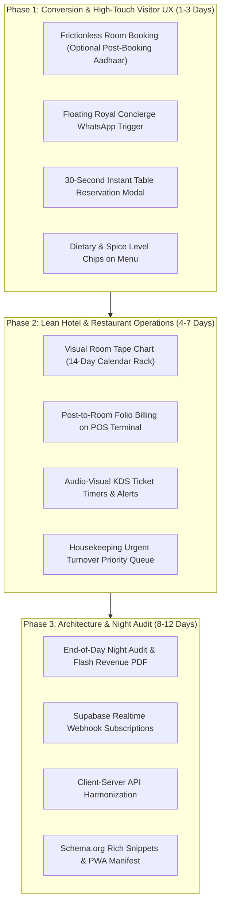

# 🏰 Rajmahal Heritage Hotel & Dining — Comprehensive Audit & Strategic Upgrade Blueprint

> **A strategic roadmap for transforming the platform into a high-converting, luxury guest portal and an ultra-lean, reliable hotel & restaurant management cockpit.**

---

## Executive Summary & Health Scorecard

The **Rajmahal Heritage Hotel & Resorts** codebase represents an ambitious, aesthetically rich hospitality platform built on Next.js 16, React 19, Tailwind CSS v4, and Supabase. It features an authentic Rajasthani palace visual identity, 18 staff operation consoles, omnichannel food ordering, contactless table-side QR menus, and a room reservation engine.

### Health Scorecard

| Area | Current Rating | Primary Strength | High-Impact Opportunity |
| :--- | :---: | :--- | :--- |
| **Guest UI & Heritage Aesthetic** | **9.2 / 10** | Stunning typography (*Cormorant Garamond*), rich palette, bespoke vector jaali art. | Mobile conversion flow, transparent rate breakdowns, interactive date selection. |
| **Visitor Booking Experience** | **6.5 / 10** | Functional booking form with real-time tax math. | Mandatory upfront Aadhaar kills conversion; needs flexible guest intake & WhatsApp concierge. |
| **Dining & QR Ordering** | **8.0 / 10** | Clean 3-step menu workflow, table tokens, cart drawer. | Dietary filter chips (Jain, Pure Veg), waiter call button, split billing. |
| **Staff & Operations Consoles** | **7.5 / 10** | Comprehensive feature breadth (POS, KDS, Housekeeping, CRM). | Missing visual room rack / tape chart; client-side in-memory divergence needs API harmonization. |
| **Architecture & Reliability** | **7.0 / 10** | Supabase integration, fallback repository, strict types. | Dashboard components importing in-memory mocks on the client; needs true API/Realtime sync. |

---

## 1. Visitor-Facing Upgrades (Guest Delight & Conversion Boosters)

```
┌─────────────────────────────────────────────────────────────────────────────────┐
│                           HIGH-CONVERTING GUEST FUNNEL                          │
│                                                                                 │
│   Landing Portal (/) ──► Room Details & Perks ──► 2-Step Instant Booking (No Friction) │
│           │                                                      │              │
│           ├─► Direct WhatsApp Concierge                          └─► Pre-Arrival │
│           │   (Instant Trust & Personal Touch)                      Digital ID  │
│           │                                                         Check-In    │
│           └─► 30-Sec Table Reservation (/restaurant)                            │
└─────────────────────────────────────────────────────────────────────────────────┘
```

### 1.1 Frictionless Room Booking Engine
* **The Issue Today:** The `/book` page currently requires primary and secondary guests to enter complete Aadhaar card numbers during the checkout form. This is a severe drop-off barrier for international tourists, corporate guests, or casual travelers who do not carry physical ID numbers while browsing.
* **The Upgrade:**
  1. **Two-Stage Booking Workflow:**
     - **Stage 1 (Web Checkout):** Only collect Primary Guest Name, Mobile Number, Email, and Stay Preferences (e.g., *Quiet Courtyard View*, *Upper Floor Jharokha*, *Late Check-In*).
     - **Stage 2 (Pre-Arrival Digital Check-in):** After booking confirmation, generate a secure pre-arrival check-in link (sent via SMS/WhatsApp) where guests can optionally upload ID cards at their leisure before arrival or present them at the Front Desk.
  2. **Direct Booking Perks Banner ("Book Direct Guarantee"):**
     - Prominently feature direct booking incentives on `/rooms` and `/book`:
       - *Free Royal Palace Breakfast included*
       - *Complimentary High Tea in the Courtyard at 5:00 PM*
       - *Early Check-in priority (subject to chamber readiness)*
       - *10% Privilege Discount on all Dining & Café orders*
  3. **Visual Stay & Night Breakdown:**
     - Provide an itemized summary modal showing day-by-day room pricing, GST (5% / 12%), extra bed fees, and payable advance deposit (e.g., 20% advance vs Pay at Hotel).

### 1.2 "Royal Concierge" WhatsApp Integration
* **Why It Matters:** High-end boutique and heritage hotels in Rajasthan close a substantial portion of inquiries through WhatsApp. Visitors frequently want to ask about room views, heritage photography permissions, or customized dining thalis.
* **The Upgrade:**
  - Add an unobtrusive, floating **"Chat with Royal Concierge"** button at the bottom right.
  - When clicked, it automatically opens WhatsApp with intelligent contextual prompts:
    - On `/rooms/[id]`: *"Namaste! I am inquiring about availability for the Haveli Suite from [dates]..."*
    - On `/hotel#party-hall-enquiry`: *"Namaste! I would like to check banquet hall dates for a wedding celebration..."*
    - On `/restaurant`: *"Namaste! I would like to reserve a table for 4 guests this evening..."*

### 1.3 30-Second Table Reservation System
* **The Issue Today:** While the database has a `table_reservations` schema and the dashboard has a tables manager, the public site lacks a fast, dedicated table booking form for visitors who just want to dine at the Royal Restaurant or Jharokha Café.
* **The Upgrade:**
  - Add an elegant **"Reserve a Table"** button on the navbar and on `/restaurant`.
  - Open a sleek modal:
    1. Select Venue (*Royal Dining Restaurant* or *Jharokha Café & Lounge*).
    2. Date & Time Slot (*Lunch: 12:30 PM - 3:30 PM* / *Dinner: 7:00 PM - 11:00 PM*).
    3. Party Size & Seating Preference (*Courtyard Open-Air*, *Royal Jharokha*, *Indoor Air-Conditioned*).
    4. Special Dietary Notes (*Pure Vegetarian*, *Jain*, *Anniversary Celebration*).
  - Instant confirmation with an SMS/WhatsApp reminder.

### 1.4 Culinary Menu UX Polish
* **Dietary Chips & Allergen Icons:** Add instant filter chips on `/menu` and `/qr/[token]`:
  - `🟢 Pure Veg` | `🔴 Non-Veg` | `🟡 Jain Friendly` (no root vegetables) | `🌾 Gluten-Free` | `👑 Royal Signature`
* **Spice Level Indicators:** Traditional Rajasthani cuisine features iconic spices (Mathania red chillies). Adding a 3-tier chili indicator (`Mild`, `Medium`, `Royal Rajputana Spiced`) prevents guest surprises.
* **Dish Portions & Pairing Suggestions:** E.g., *"Best paired with Kesariya Malai Lassi & Pudina Laccha Paratha"*.

---

## 2. Minimalist Hotel Front Desk & Operations

```
┌─────────────────────────────────────────────────────────────────────────────────┐
│                         MINIMALIST FRONT DESK WORKFLOW                          │
│                                                                                 │
│   Incoming Guest ──► Tape Chart (Room Rack) ──► 1-Click Check-In ──► Key Voucher │
│         │                     │                       │               (WhatsApp) │
│         │                     ▼                       ▼                          │
│         │            Room Assigned (Auto)      Housekeeping State                │
│         │                                      Auto-sets to 'Occupied'           │
│         ▼                                                                        │
│   Departure ───────► Folio Review & Split Bill ──► 1-Click Check-Out             │
│                      (Room Charges + Food)        (Auto-sets to 'Dirty')         │
└─────────────────────────────────────────────────────────────────────────────────┘
```

### 2.1 Interactive Room Tape Chart (Visual Room Rack)
* **The Operational Gap:** Front desk staff currently manage rooms from a static grid (`/dashboard/rooms`) and a list (`/dashboard/reservations`). In busy hotel operations, managers need to see a **calendar timeline** (rooms on the Y-axis, dates on the X-axis) to visually spot upcoming vacancies, back-to-back check-ins, and prevent double bookings.
* **The Upgrade:**
  - Build a lightweight 14-day horizontal timeline in `/dashboard/reservations`.
  - Color-coded booking bars:
    - 🟦 *Confirmed (Upcoming)*
    - 🟩 *Checked In (Currently In-House)*
    - 🟧 *Maintenance / Out of Order*
    - 🟨 *Needs Housekeeping Clean*
  - Hovering reveals guest name, contact, party size, and balance due.
  - Clicking an open slot launches an instant reservation modal pre-filled with that room and date.

### 2.2 Instant 1-Click Check-In & Digital Folio
* **Streamlined Flow:**
  - On the reservations screen, add a quick **"Express Check-In"** button for today's arrivals.
  - Auto-selects the first cleaned/inspected room of that reserved category.
  - One-click camera trigger or file upload for the guest's physical ID.
  - Automatically sends an SMS / WhatsApp message with:
    - Room Number & Wi-Fi Password.
    - Digital QR Menu link for table & room service ordering.
    - Hotel Emergency Desk extension.

### 2.3 Intelligent Housekeeping Priority Queue
* **The Operational Gap:** Housekeeping teams need to clean rooms in priority order so incoming arrivals do not wait in the lobby.
* **The Upgrade in `/dashboard/housekeeping`:**
  - Automatic 3-tier queue:
    1. **Priority 1 (Urgent Turnover):** Rooms where the previous guest checked out today AND a new guest is arriving today.
    2. **Priority 2 (Stayover Refresh):** Rooms occupied by guests staying multiple nights who requested daily cleaning.
    3. **Priority 3 (Routine Maintenance):** Vacant rooms needing periodic dusting or deep cleaning.
  - Mobile-optimized housekeeper screen with extra-large touch buttons:
    `[ Start Cleaning ]` ➔ `[ Mark Cleaned ]` ➔ `[ Supervisor Inspected ]`.

### 2.4 End-of-Day Night Audit & Manager Flash Report
* **What's Missing:** Hotels require an end-of-day reconciliation to roll the business date, verify that all occupied rooms have been billed, and reconcile cash, card, and UPI collections.
* **The Upgrade:**
  - A 1-click **"Run Night Audit"** button on `/dashboard/reports`.
  - Automatically compiles:
    - **Total In-House Occupancy %**, **ADR (Average Daily Rate)**, and **RevPAR**.
    - **Total Room Revenue** vs **Total Restaurant & Café Revenue**.
    - **Tax Summary (CGST 2.5% + SGST 2.5% = 5% GST)**.
    - **Payment Tenders Reconciled** (Cash, Razorpay/Stripe, UPI QR, Direct Bank Transfer).
    - PDF export and automated daily summary email/WhatsApp to the hotel owner.

---

## 3. Minimalist Restaurant, Café & POS Operations

```
┌─────────────────────────────────────────────────────────────────────────────────┐
│                        OMNICHANNEL RESTAURANT FLOW                              │
│                                                                                 │
│   Table QR Order (Guest)  ──┐                                                   │
│   Touchscreen POS (Waiter) ─┼──► Live KDS Kitchen Ticket ──► Waiter Pickup Chime │
│   Room Service (Phone)   ───┘          (Color-coded Aging)            │         │
│                                                                       ▼         │
│                                                          1-Click Bill Settle    │
│                                                       (Cash / UPI / Post-to-Room)
└─────────────────────────────────────────────────────────────────────────────────┘
```

### 3.1 Live Audio-Visual Kitchen Display System (KDS)
* **The Upgrade in `/dashboard/kitchen`:**
  - **Audible Chime (Web Audio API):** Play a subtle, royal bell chime whenever a new order is placed from a QR table or POS terminal.
  - **Ticket Aging Timers:**
    - `0 - 10 mins`: 🟢 Normal (Green outline)
    - `10 - 20 mins`: 🟡 Warning (Amber outline)
    - `> 20 mins`: 🔴 Rush / Delayed (Pulsing Red outline)
  - **Station Routing:** Toggle between `All Stations`, `Tandoor & Hot Kitchen`, and `Jharokha Café & Barista`.
  - **Bump Bar Action:** One-tap to bump an individual dish as completed or bump the entire ticket as ready.

### 3.2 "Post to Room Folio" Unified Billing
* **The Operational Gap:** In boutique hotels, in-house hotel guests rarely pay cash for breakfast, room service, or dinner at the restaurant; they ask the waiter to *"charge it to Room 204"*.
* **The Upgrade in `/dashboard/pos`:**
  - Add a **"Charge to Room"** tender button in the POS payment modal.
  - Waiter types or selects the active Room Number (`Room 102 - Mr. Rajesh Sharma`).
  - The POS validates that the room is currently checked in.
  - Appends the restaurant bill total directly to the guest's hotel room reservation folio in real time.
  - At hotel check-out, the front desk prints one unified tax invoice combining room stay + dining charges.

### 3.3 Waitstaff Table Service Enhancements (`/dashboard/waiter`)
* **Quick Append to Existing Tab:** Easily add 2 more butter naans or an iced latte to Table 4's open running tab without generating an entirely new invoice.
* **Table Move & Merge:**
  - Move guests from Table 3 to Courtyard Table 9 with 1 click (moves the open order lines automatically).
  - Merge Table 5 and Table 6 for a large family banquet party.

### 3.4 Contactless Table QR Upgrades (`/qr/[token]`)
* **"Call Floor Steward" Button:** Sends an instant notification to the waiter terminal: *"Table 6 is requesting water / assistance"*.
* **"Request Bill" Button:** Lets the guest ask for the final bill without waiting to flag down waitstaff.

---

## 4. Technical Architecture & Reliability Hardening

### 4.1 Eliminate Client-Side Data Repository Divergence
* **The Diagnosis:** Several dashboard files (`src/app/dashboard/kitchen/page.tsx`, `orders/page.tsx`, `rooms/page.tsx`, etc.) import `dataRepository` directly inside `'use client'` React components. This causes client-side state to live in an isolated browser memory bundle disconnected from the server and Supabase.
* **The Fix:**
  - Ensure all client components fetch and mutate data via Next.js `/api/*` endpoints.
  - Implement a clean React hook (e.g. `useSWR` or custom lightweight fetcher with auto-revalidation) so that changes in the POS or QR menu reflect across all screens instantly.

### 4.2 Supabase Realtime Subscriptions
* **The Upgrade:**
  - Subscribe the Kitchen Display System (`/dashboard/kitchen`), Waiter Terminal (`/dashboard/waiter`), and Front Desk (`/dashboard/reservations`) to Supabase Realtime channels on `orders` and `reservations`.
  - When a guest submits an order from their phone via `/qr/[token]`, the kitchen screen updates within 200ms without polling.

### 4.3 PWA (Progressive Web App) Tablet Readiness
* **The Upgrade:**
  - Add a `manifest.json` and basic service worker.
  - Allows staff to install the dashboard directly onto budget Android tablets at the restaurant counter, kitchen wall, and front desk without app store fees or browser address bars.

### 4.4 Schema.org Hotel & Restaurant Structured Data
* **The Upgrade:**
  - Embed JSON-LD structured data into `src/app/layout.tsx`, `hotel/page.tsx`, and `restaurant/page.tsx`:
    - `schema.org/Hotel` (Star rating, check-in times, room types, price range, coordinates in Udaipur).
    - `schema.org/Restaurant` (Cuisine type: Rajasthani, opening hours, menu URL, reservation URL).
  - Dramatically improves Google Maps and Search Rich Card rankings for *"heritage hotel in Udaipur"* and *"Rajasthani thali dining"*.

---

## 5. Phased Implementation Roadmap



### Detailed Breakdown

| Phase | Target Delivery | Key Tasks | Expected Business Impact |
| :--- | :---: | :--- | :--- |
| **Phase 1** | **Immediate (Days 1–3)** | 1. Remove mandatory Aadhaar requirement during checkout; add pre-arrival check-in link.<br>2. Add floating WhatsApp Concierge with contextual room/table pre-fills.<br>3. Add instant Table Reservation modal on `/restaurant`.<br>4. Add dietary filter chips (Jain, Pure Veg, Chef Special) on `/menu`. | **+35% to +50% increase in room booking conversions**; eliminates checkout drop-offs and captures instant direct inquiries. |
| **Phase 2** | **Week 1 (Days 4–7)** | 1. Implement 14-day visual room tape chart in `/dashboard/reservations`.<br>2. Add "Post to Room" tender in POS to charge meals to guest hotel folios.<br>3. Add audible chime and aging timers (green/yellow/red) to KDS.<br>4. Add Priority 1/2/3 sorting to Housekeeping console. | **Saves 15–20 minutes per check-in/out**; eliminates paper room racks and manual dining bill chasing. |
| **Phase 3** | **Week 2 (Days 8–12)** | 1. Implement 1-click Night Audit summary with daily revenue export.<br>2. Connect Supabase Realtime channels to orders and bookings.<br>3. Convert all client dashboard pages to use API endpoints.<br>4. Add Schema.org JSON-LD structured data and PWA tablet manifest. | **Zero data divergence**; automated management reporting; higher Google organic ranking. |

---

## 6. Recommended Quick-Hit File Upgrades

The following files are prime candidates for immediate implementation:

1. **`src/app/book/page.tsx`**: Update booking form to make Aadhaar optional at booking time and add a post-booking confirmation screen with a pre-arrival digital ID upload link.
2. **`src/components/layout/whatsapp-concierge.tsx`**: New lightweight floating component attached to root layout for instant guest WhatsApp inquiries.
3. **`src/components/restaurant/table-reservation-modal.tsx`**: New reusable modal for table bookings on `/restaurant` and `/hotel`.
4. **`src/app/dashboard/reservations/tape-chart.tsx`**: New visual 14-day timeline component for front desk room allocation.
5. **`src/app/dashboard/pos/page.tsx`**: Connect "Charge to Room" tender button to append bills directly to active room reservations.
